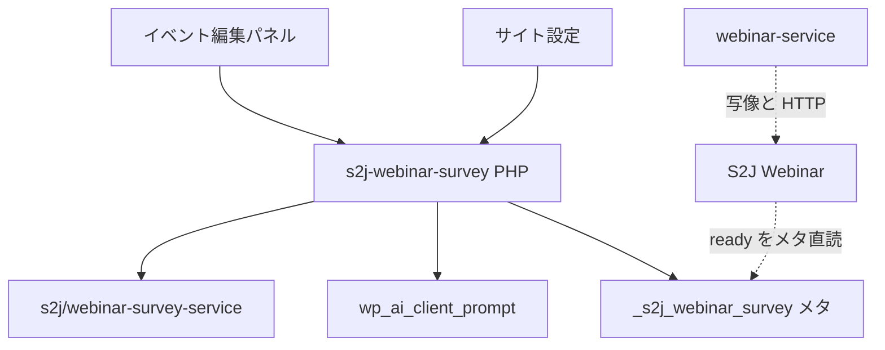

# S2J Webinar Survey - アーキテクチャー

## 設計意図 (ゴール)

設問の編集・保存・不足と助言のメッセージ表示・下書き UX を WordPress 側に閉じ、判定本体を Composer ライブラリに委ねます。GatherPress フォークは改変しません。

## 設計方針

* 本プラグインはアダプタ。FOP (Functional Object-Oriented Programming) の計算はサービス。
* フック登録、設定、メタ、コネクタ呼び出しは本プラグイン。

## レイヤー構成

| 層 | 責務 | 非責務 |
| --- | --- | --- |
| UI (React / パネル) | 入力、不足と助言のメッセージ表示、下書き候補の採用 UI | 不足判定の本体。Service の直接呼び出し |
| Plugin PHP | フック、メタ、option、サービス呼び出し (`evaluate` / 下書き bridge。REST 等)、コネクタ、下書きテスト用 filter `s2j_webinar_survey_draft_ai_text` | Zoom HTTP |
| Survey Service | `evaluate` / `build_draft_prompt` / `parse_draft_response` | WP / Zoom |

`evaluate` (表示専用含む) も下書きも、**UI → 本プラグイン PHP (REST 等) → Service** とする。クライアントから Service を直接呼ばない。表示専用は `POST …/v1/evaluate` (初版出力はコード列のみ)、下書きは `POST …/v1/draft` (1リクエスト)。契約の正本は [persistence_spec.md](./persistence_spec.md) / [draft_ui_spec.md](./draft_ui_spec.md)。パネル文書は `_s2j_webinar_survey` を `register_post_meta` (`object` / `show_in_rest` / `edit_post` 相当の auth) で載せ、保存は `save_post` で正規化上書きする (クライアントの `status` は信頼しない)。



S2J Webinar 向けの公開 PHP / REST bridge は初版に置かない。受け渡しは [persistence_spec.md](./persistence_spec.md) である。

## フォルダー構成 (想定)

公開の計算面は、サービス側の名前空間の関数3つだけです。本プラグインは、それらを呼ぶ薄い橋です。

```plaintext
s2j-webinar-survey/
├── README.md
├── LICENSE
├── composer.json              # require s2j/webinar-survey-service
├── package.json
├── s2j-webinar-survey.php
├── uninstall.php
├── docs/                      # 確定仕様 (governance / archive 含む)
├── docs_mod/                  # 改訂案と進行中イニシアチブ証跡
├── includes/                  # PHP (Settings、Meta、REST evaluate/draft、AiTextGeneration)
├── src/
│   ├── domain/                # document、question、evaluationMessages
│   └── gutenberg/             # Document Settings、Modal、CRUD、meta sync
├── tests/
│   ├── Unit/                  # 段階3a (WP 不要)
│   ├── Integration/           # 段階3b (MySQL + WP テスト lib)
│   ├── smoke-local.sh         # 段階1 (WP-CLI)
│   └── stubs/                 # IDE / Intelephense 用 (実行時は WP テスト lib)
├── bin/                       # phpunit-local.sh、install-wp-tests.sh
├── studio/                    # 段階2 Blueprint
├── languages/
└── vendor/                    # Composer (配布物では同梱方針に従う)
```

## 技術スタック

| 項目 | 方針 |
| --- | --- |
| PHP | 本プラグイン **v8.3以上** ([WordPress 必須要件](https://ja.wordpress.org/about/requirements/))。Composer 依存 `s2j/webinar-survey-service` は PHP v8.1以上 |
| UI | React (Vite)。イベント編集パネル + サイト設定 |
| 依存ライブラリ | `s2j/webinar-survey-service` |
| 下書き | `wp_ai_client_prompt()` (コネクタ)。キーは持たない |
| ドキュメント lint | `@s2j/docs-linter` / `npm run lint:docs` |
| PHP 自動テスト | PHPUnit 9。wp-env / Docker は **採用しない** (MLDC / S2J Webinar 3b 同型) |

## 検証 (段階1–3)

正本: [test-results.md](./test-results.md) / 進捗 [status.md §品質](./status.md#status-quality)。

| 段階 | npm / スクリプト | 内容 |
| --- | --- | --- |
| **1** | `npm run test:smoke:local` | `tests/smoke-local.sh` — 有効化、`ServiceBridge::evaluate`、evaluate / draft REST ルート |
| **2** | `studio/smoke-test-blueprint.json` | GatherPress 同梱サイト + 段階1 |
| **3a** | `npm run test:unit:php:unit-only` | `tests/Unit/` (CI: `.github/workflows/phpunit.yml`、PHP **v8.3**、wp-env なし) |
| **3b** | `npm run test:unit:php:local` | unit + `tests/Integration/` (MySQL、`.env.tests`) |
| **lint** | `npm run lint:php` / `npm run lint:docs` | PHPStan + PHPCS、textlint (`docs-lint.yml`) |
| **一括 (Local)** | `npm run test:quality:local` | 3a → lint:php → 3b |

統合テストの代表: evaluate / draft ルート、option、メタ REST、filter モック draft、Zoom 非接触 uninstall (`uninstall.php`)。

## プラグインとの境界 (外)

| 置き場 | 中身 |
| --- | --- |
| 本プラグイン | 編集、保存、メッセージ表示 (i18n)、コネクタ、上限のサイト設定 |
| Survey Service | 計算 |
| S2J Webinar / webinar-service | Zoom 添付 |

## 関連

* 原則: [principles.md](./principles.md)
* サービス構成: [survey-service architecture](https://github.com/stein2nd/s2j-webinar-survey-service/blob/main/docs/architecture.md)
